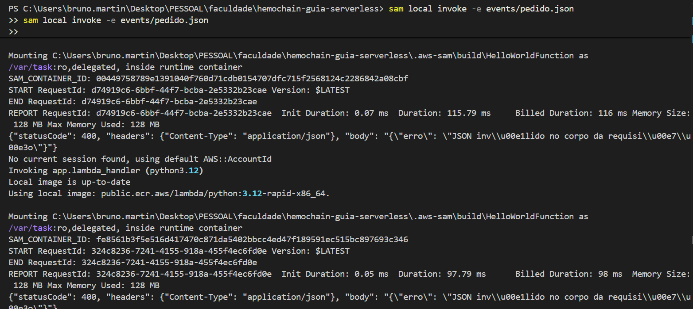
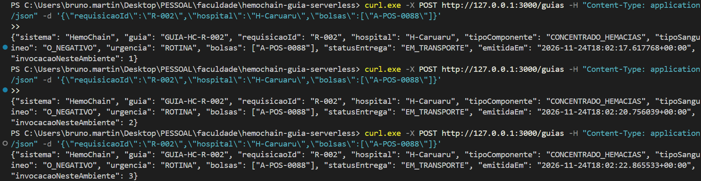
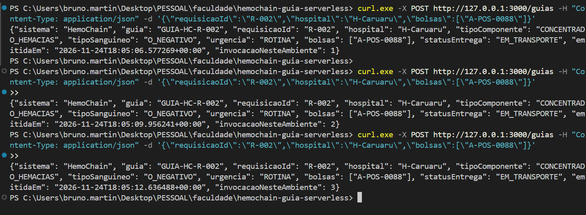
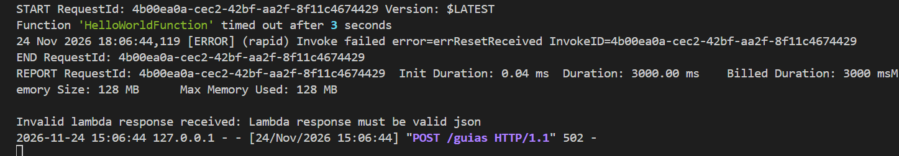
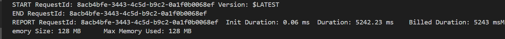

# HemoChain — Emissão de Guia de Transporte (Serverless)

**Atividade Individual 1 (Unidade II) — Serverless**  
**Disciplina:** Infraestrutura de Software · ADS · CESAR School · 2026.2  
**Autor:** Bruno Sottomayor Martin  
**Sistema de referência:** [HemoChain (`mateusoliveiraadev/HemoChain`)](https://github.com/mateusoliveiraadev/HemoChain)  
**Vídeo de demonstração (até 3 min):** _[Inserir link do vídeo aqui]_

---

## Visão geral

Função serverless acionada por **evento** e por **HTTP (`POST /guias`)** que recebe uma requisição hospitalar no vocabulário do **HemoChain** (`RequisicaoHospitalar`) e devolve a guia de transporte de hemocomponentes (`EntregaHospitalar`), contendo código da guia, hospital solicitante, tipo de componente (`CONCENTRADO_HEMACIAS`), tipo sanguíneo, urgência, bolsas vinculadas e timestamp de emissão.

O objetivo prático é demonstrar o ciclo de vida de uma função serverless:
1. **Cold start vs. execuções subsequentes** (fase de *Init* e tempos registrados);
2. **Ausência de estado garantido em memória** (comportamento de variável global sem e com `--warm-containers LAZY`);
3. **Limite de tempo de execução (Timeout)** (erro ao estourar `3s` e recuperação após ajuste para `10s`).

---

## Caminho e stack escolhidos

* **Caminho A (local):** AWS SAM CLI (`1.174.0`) + Docker Desktop + Python `3.12` (sem necessidade de conta AWS).
* **Configuração da função (`template.yaml`):**
  * **Runtime:** `python3.12`
  * **Memória:** `128 MB`
  * **Timeout inicial:** `3s` (alterado para `10s` no experimento de timeout)
  * **Gatilho HTTP:** `POST /guias`

### Estrutura do repositório

```text
hemochain-guia-serverless/
├── template.yaml                  # Definição SAM (função, memória, timeout e rota POST /guias)
├── hello_world/
│   ├── app.py                     # Handler lambda_handler (emissão da guia HemoChain)
│   └── requirements.txt
├── events/
│   └── pedido.json                # Evento API Gateway Proxy usado no sam local invoke
├── evidencias/
│   ├── 01-invoke-evento.png       # 2 invocações por evento com tempos registrados
│   ├── 02-http-cold.png           # 3 chamadas HTTP sem --warm-containers
│   ├── 03-http-warm.png           # 3 chamadas HTTP com --warm-containers LAZY
│   ├── 04-timeout-erro.png        # Erro de timeout (3s) com demorar=true
│   └── 05-timeout-ajustado.png    # Sucesso após ajuste do timeout para 10s
└── README.md
```

---

## Como reproduzir localmente

### Pré-requisitos
* Docker Desktop em execução
* AWS SAM CLI (`sam --version`)
* Python 3.12 (`python --version`)

### 1. Build da função
```bash
sam build
```

### 2. Invocação por evento (2x)
```bash
sam local invoke -e events/pedido.json
sam local invoke -e events/pedido.json
```

### 3. Gatilho HTTP sem reaproveitamento de container (Cold)
**Terminal 1:**
```bash
sam local start-api
```
**Terminal 2** (executar 3 vezes):
```bash
curl -X POST http://127.0.0.1:3000/guias \
  -H "Content-Type: application/json" \
  -d '{"requisicaoId":"R-002","hospital":"H-Caruaru","bolsas":["A-POS-0088"]}'
```

### 4. Gatilho HTTP com reaproveitamento de container (`LAZY`)
**Terminal 1:**
```bash
sam local start-api --warm-containers LAZY
```
**Terminal 2:** repetir a mesma chamada `curl` 3 vezes e observar o incremento do campo `invocacaoNesteAmbiente` (`1 → 2 → 3`).

### 5. Experimento de Timeout (`3s` → `10s`)
Com `Timeout: 3` no `template.yaml` e `sam local start-api` rodando, enviar:
```bash
curl -X POST http://127.0.0.1:3000/guias \
  -H "Content-Type: application/json" \
  -d '{"requisicaoId":"R-003","hospital":"H-Recife","demorar":true}'
```
Após registrar o erro de timeout (`3000.00 ms` / HTTP `502`), alterar `Timeout: 10` em `template.yaml`, executar `sam build`, subir `sam local start-api` novamente e repetir a chamada acima.

---

## Resultados registrados e Evidências

| Experimento | Evidência | Resultado observado |
|---|---|---|
| **1. Invocação por evento (2x)** | [`evidencias/01-invoke-evento.png`](./evidencias/01-invoke-evento.png) | 1ª execução: `Duration: 115.79 ms` (`Billed: 116 ms`) · 2ª execução: `Duration: 97.79 ms` (`Billed: 98 ms`) |
| **2. HTTP sem warm containers** | [`evidencias/02-http-cold.png`](./evidencias/02-http-cold.png) | Novo ambiente criado por requisição (`invocacaoNesteAmbiente` reinicia sem garantia de persistência) |
| **3. HTTP com `--warm-containers LAZY`** | [`evidencias/03-http-warm.png`](./evidencias/03-http-warm.png) | Mesmo container reutilizado entre chamadas: `invocacaoNesteAmbiente` incrementou `1 → 2 → 3` |
| **4. Timeout de 3s excedido** | [`evidencias/04-timeout-erro.png`](./evidencias/04-timeout-erro.png) | `Function 'HelloWorldFunction' timed out after 3 seconds` (`Duration: 3000.00 ms`, HTTP `502`) |
| **5. Timeout ajustado para 10s** | [`evidencias/05-timeout-ajustado.png`](./evidencias/05-timeout-ajustado.png) | Guia emitida com sucesso (`Duration: 5242.23 ms`, `Billed: 5243 ms`) |

<details>
<summary>Visualizar prints das evidências</summary>

#### 1. Invocação por evento


#### 2. Gatilho HTTP (sem warm containers)


#### 3. Gatilho HTTP (com `--warm-containers LAZY`)


#### 4. Erro de Timeout (3s)


#### 5. Sucesso após ajuste de Timeout (10s)


</details>

---

## Respostas às 5 perguntas da atividade

### 1. Por que a primeira invocação demorou mais que a segunda? O que acontece na fase de *Init*?
A primeira invocação levou **115,79 ms**, enquanto a segunda levou **97,79 ms**, devido ao **cold start**. Antes de executar o `lambda_handler`, o ambiente passa pela fase de **Init**, na qual o provedor provisiona o container/microVM, carrega o pacote de código, inicializa o runtime (`Python 3.12`) e executa o código fora do handler (imports e inicialização de variáveis globais). Nas invocações seguintes, com imagem/ambiente já preparados em cache ou aquecidos, esse custo inicial cai significativamente.

### 2. O que o campo `invocacaoNesteAmbiente` mostrou com e sem `--warm-containers`? O que isso diz sobre guardar estado numa variável global da função?
* **Sem `--warm-containers`:** o emulador recria o container a cada chamada, zerando a variável global `contador` e retornando `invocacaoNesteAmbiente: 1`.
* **Com `--warm-containers LAZY`:** o mesmo ambiente é mantido vivo entre chamadas seguidas e o contador avança (`1 → 2 → 3`).

Isso comprova que **variáveis globais não são confiáveis para armazenar estado de negócio** em arquiteturas serverless, pois o provedor pode destruir ambientes ociosos ou escalar múltiplas instâncias em paralelo a qualquer momento. Estado global deve ser usado apenas como otimização temporária (reaproveitamento de clientes HTTP ou pools de conexão); qualquer estado real deve residir em armazenamento externo (ex.: PostgreSQL, DynamoDB ou Redis).

### 3. O que aconteceu com `demorar = true`? Qual é o tempo máximo de uma execução no Lambda, e o que fazer com um trabalho mais longo?
Com `demorar = true`, a função executou `time.sleep(5)` e excedeu o `Timeout: 3` configurado no `template.yaml`. A execução foi interrompida em `3000.00 ms` com `Function 'HelloWorldFunction' timed out after 3 seconds` (HTTP `502`). Após ajustar o `Timeout` para `10` segundos e refazer o build, a requisição completou normalmente em `5242.23 ms`.

No AWS Lambda, o **limite máximo de execução é de 15 minutos (900 segundos)** por invocação — e atrás do API Gateway REST o timeout síncrono da resposta HTTP é de ~29 segundos. Para tarefas mais longas, a recomendação é **desacoplar o processamento**: aceitar a requisição rapidamente, publicar em uma fila (**SQS**) para processamento assíncrono, orquestrar etapas menores com **AWS Step Functions** ou executar em containers/jobs dedicados (**ECS/Fargate** ou **AWS Batch**).

### 4. Com os preços de `us-east-1` da aula (US$ 0,20 por milhão de requisições e US$ 0,0000166667 por GB-s), quanto custa um milhão de execuções desta função com 128 MB e 100 ms?
* **Custo de requisições:**  
  `1.000.000 × (US$ 0,20 / 1.000.000)` = **US$ 0,20**
* **Custo de computação (GB-s):**  
  * Memória em GB: `128 MB / 1024 = 0,125 GB`  
  * Duração em segundos: `100 ms = 0,1 s`  
  * Consumo por execução: `0,125 GB × 0,1 s = 0,0125 GB-s`  
  * Consumo total (1M execuções): `1.000.000 × 0,0125 GB-s = 12.500 GB-s`  
  * Valor de computação: `12.500 × US$ 0,0000166667` = **US$ 0,20833375** (≈ **US$ 0,21**)
* **Custo total (sem faixa gratuita):**  
  `US$ 0,20 + US$ 0,20833375` = **US$ 0,4083** (aproximadamente **US$ 0,41** por milhão de execuções).  
  *(Considerando a faixa sempre gratuita da AWS — 1 milhão de requisições e 400.000 GB-s/mês — esse volume custaria **US$ 0,00**.)*

### 5. Em que parte do HemoChain uma função assim faria sentido, e em qual não faria?
* **Onde faz sentido:** em fluxos pontuais, orientados a eventos e de curta duração, como a **emissão de guias de transporte** (`POST /guias`), geração de comprovantes/PDFs de entrega, envio de notificações de requisições `EMERGENCIAL` para hospitais e disparo de alertas automáticos quando uma `BolsaHemocomponente` se aproxima do vencimento (`ValidadeService`).
* **Onde NÃO faz sentido:** em serviços com **tráfego contínuo e previsível**, **transações complexas de longa duração** ou necessidade de **conexões persistentes e latência constante sem cold start** — como o núcleo transacional do HemoChain (`AtendimentoHospitalarService` e `RastreabilidadeService`, que aplicam travas pessimistas e integridade transacional no PostgreSQL) ou rotinas pesadas de consolidação de indicadores que possam ultrapassar o limite de tempo do Lambda.

---

## Uso de IA (PO-CESAR-021)

* **Ferramenta utilizada:** Gemini (Google).
* **Como foi utilizada:** Partindo da minha base prévia sobre o domínio do HemoChain e da estrutura do projeto, utilizei a ferramenta de forma pontual como apoio para orientações de configuração do ambiente local no Windows (ajuste do SAM CLI e resolução do erro no Docker), apoio na estruturação dos comandos de teste e revisão final da documentação.
* **Revisão e validação:** Todo o código, a execução dos experimentos (invocação por evento, `cold` vs. `warm containers` e timeout `3s → 10s`) e a coleta dos resultados reais foram feitos e validados localmente na minha máquina, conforme registrado nos prints da pasta `evidencias/`.
